# 🎲 Перудо — тренажёр и игра в браузере

Играйте в **Перудо** (она же «Дудо», «Игра лжецов» с кубиками) против компьютерных соперников и учитесь считать шансы: приложение подсказывает, насколько вероятна чужая ставка, разбирает ваши решения и тренирует главные навыки игры.

**▶ [Открыть приложение](https://wwwoper.github.io/perudo-trainer/)**

[](https://github.com/Wwwoper/perudo-trainer/actions/workflows/test.yml)
[](LICENSE)

Ничего устанавливать не нужно: приложение работает прямо в браузере на компьютере, планшете и телефоне, без регистрации и без рекламы.

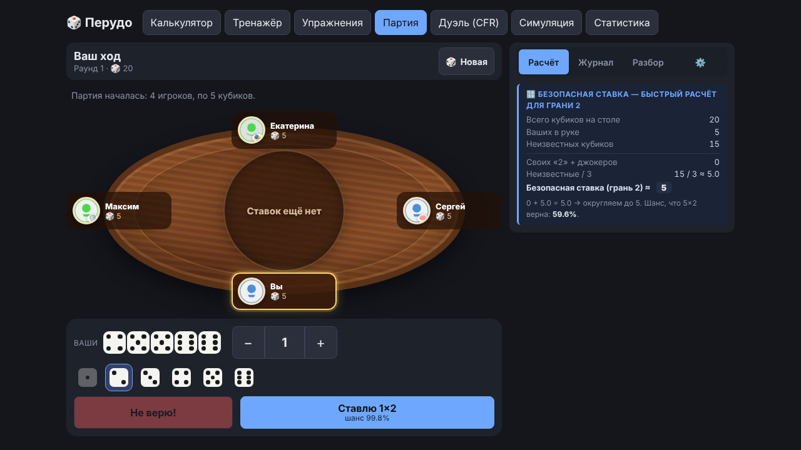

---

# Часть 1. Для игроков

## Что такое Перудо

У каждого игрока есть стакан с кубиками, которые видит только он сам. Игроки по очереди делают **ставки** о том, сколько кубиков с определённым числом лежит на столе *у всех вместе*: «шесть пятёрок», «восемь троек». Каждая следующая ставка должна быть выше предыдущей. Если вы считаете, что предыдущий игрок преувеличил, говорите **«Не верю!»** — и все открывают кубики. Кто оказался неправ, теряет один кубик. Кто потерял все кубики, выбывает. **Побеждает последний оставшийся игрок.**

Главная хитрость: вы знаете свои кубики и можете только прикидывать чужие. Именно эту прикидку — расчёт шансов — и помогает освоить приложение.

## С чего начать

Если вы только знакомитесь с Перудо, проходите разделы по порядку:

1. **[Калькулятор](#калькулятор)** — привыкните, что шанс ставки считается по вашим кубикам и числу чужих.
2. **[Упражнения](#упражнения)** — потренируйте счёт в уме, пока цифры не станут привычными.
3. **[Тренажёр](#тренажёр)** — принимайте решения «верить или нет» в готовых ситуациях.
4. **[Партия](#партия)** — сыграйте с ботами; в режиме «Новичок» приложение подсказывает ход.
5. **[Дуэль (CFR)](#дуэль-cfr)** — проверьте себя против бота с почти оптимальной стратегией.

Если правила вам уже знакомы, сразу откройте [Партию](#партия).

## Правила игры (как они работают в приложении)

**Ставка.** Это пара «сколько × какая цифра», например «6 × 5». Новая ставка должна быть выше предыдущей одним из способов:

| Что делаете | Пример (до этого было «6 × 5») |
|---|---|
| Увеличиваете количество | «7 × 3», «7 × 5», «8 × 2» |
| Оставляете то же количество, но называете цифру больше | «6 × 6» |
| Переходите на единицы — достаточно **половины** (с округлением вверх) | «3 × 1» |
| Переходите с единиц на другую цифру — нужно **удвоить и прибавить один** | с «3 × 1» на «7 × 4» |

**Единицы — джокеры.** При подсчёте единица засчитывается как любая цифра. Поэтому «шесть пятёрок» считается по пятёркам *и* единицам. В обычном раунде первая ставка не может быть на единицы.

**«Не верю!»** Все открывают кубики. Если на столе нашлось не меньше, чем заявлено, ставка верна, и **теряет кубик тот, кто усомнился**. Если меньше — теряет кубик тот, кто ставил.

**Новый раунд.** Все перебрасывают кубики. Первым ходит тот, кто проиграл проверку (если он выбыл — следующий за ним игрок). Исключения: после верной Calza первым ходит автор ставки, а в раунде Палифико — игрок с одним кубиком.

**Calza** *(по желанию, включается в настройках).* Вместо «Не верю!» можно сказать «Calza», то есть «на столе ровно столько, сколько заявлено». Если угадали — вы получаете кубик обратно (но не больше, чем было в начале). Если ошиблись — теряете кубик. Calza доступна, пока на столе осталось не меньше половины от начального количества кубиков.

**Палифико** *(по желанию).* Когда у игрока остаётся **один** кубик, раунд идёт особо: единицы больше не джокеры, а цифру, с которой начали, менять нельзя, можно только увеличивать количество. Палифико бывает один раз для каждого игрока и только пока за столом больше двух игроков. Исключение: если игрок с одним кубиком верно назвал Calza и вернул себе второй кубик, право на Палифико к нему возвращается и при следующем падении до одного кубика раунд снова пройдёт по правилам Палифико.

## Разделы приложения

Вкладки идут в порядке «от простого к сложному». Названия в таблице — ссылки на подробное описание.

| Раздел | Для чего нужен |
|---|---|
| [**Калькулятор**](#калькулятор) | Вводите свои кубики и ставку соперника — получаете шанс, что ставка верна, и вердикт «верить или нет». Ниже — таблица ваших лучших ставок |
| [**Тренажёр**](#тренажёр) | Вам показывают игровую ситуацию, вы выбираете «Не верю!» или «Ставлю». Приложение оценивает решение. Ошибочные ситуации возвращаются, пока вы не решите их верно два раза подряд |
| [**Упражнения**](#упражнения) | Тренировка счёта в уме: «Оценка в уме» (сколько кубиков ожидать на столе) и «Правило единиц» (как пересчитывать ставку при переходе на единицы и обратно) |
| [**Партия**](#партия) | Полноценная игра против 1–5 компьютерных игроков с подсказками и разбором ходов |
| [**Дуэль (CFR)**](#дуэль-cfr) | Игра один на один (по одному кубику) против бота с близкой к оптимальной стратегией. Стратегия рассчитывается в вашем браузере за секунды |
| [**Симуляция**](#симуляция) | Проверка формул: компьютер бросает кубики тысячи раз и показывает, как часто ставка оказывается верной |
| [**Статистика**](#статистика-и-ваши-данные) | Итоги, слабые темы и список партий; имя и аватар игрока; сохранность данных: копия на Яндекс Диске и в файле |

## Калькулятор

Отвечает на главный вопрос игры: **«Верить ставке соперника или нет?»**

1. Укажите **всего кубиков** на столе (по умолчанию 15) и отметьте, считаются ли единицы джокерами.
2. Введите **свои кубики**: нажимайте цифры на панели или возьмите «Случайную руку».
3. Введите **ставку соперника**, например «7 × 5».
4. Получите **шанс, что ставка верна**, и вердикт: «Верю» или «Не верю».

Дополнительные поля:

| Поле | Что значит |
|---|---|
| **Порог** | шанс, начиная с которого ставка считается правдоподобной (по умолчанию 0,5, то есть 50%); от него зависит вердикт |
| **Кубиков у игроков, ставивших на эту цифру** | если соперники уже называли эту цифру, укажите, сколько кубиков у них, по вашему мнению, на ней; появится вторая оценка «с учётом чтения ставок» |
| **Доверие к ставкам** | насколько сильно учитывать эту подсказку (0,25 по умолчанию) |

Ниже таблица **«Ваши лучшие ставки»**: по каждой цифре видно, сколько у вас таких кубиков, максимальное количество, которое ещё проходит порог, его шанс и шанс ставки «на один больше».

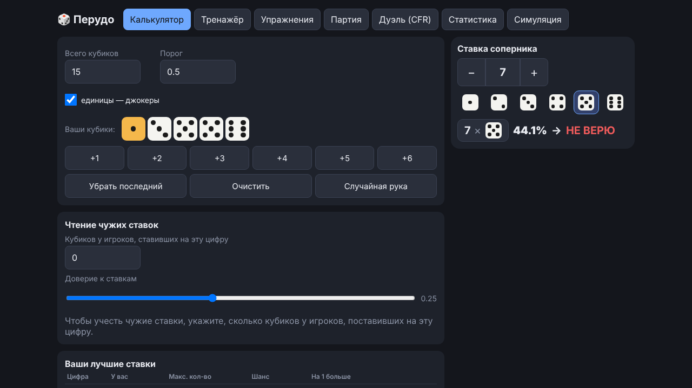

*Калькулятор: вводите свои кубики и ставку соперника, приложение подсказывает, верить ли ей.*

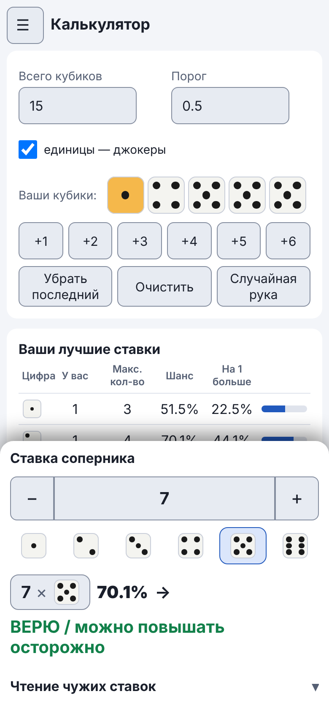

*На телефоне ставка и результат лежат в панели у нижнего края экрана, в зоне большого пальца; на широком экране это правая колонка.*

## Тренажёр

Короткие учебные ситуации: приложение показывает ваши кубики и ставку соперника, вы выбираете **«Не верю!»** или свою ставку и сразу видите, правильно ли решили.

1. Нажмите **«Новая ситуация»**.
2. Посмотрите свои кубики и ставку соперника.
3. Нажмите **«Не верю!»** или выберите свою ставку и нажмите **«Ставлю»**. Поля ставки сразу заполнены минимальной допустимой ставкой.
4. Прочитайте оценку: шанс, что ставка верна, и порог. Ниже — **варианты хода по шансу ставки**: «Не верю» (с каким шансом проверка сработает), минимальное повышение и самая сильная безопасная ставка; ваш выбор отмечен. Это сравнение по шансам, а не оценка выигрыша: оно не говорит, какой ход «лучший», а показывает цену каждого.

**Ставка должна быть допустимой по правилам.** Если ставка не проходит (например, `6×4` после `4×1`: на другую цифру после единиц нужно не меньше `4×2 + 1 = 9`), приложение объясняет, какая ставка минимальна, не оценивает её, и в статистику она не попадает. В режиме «Без джокеров / Палифико» можно повышать только количество на ту же цифру. Если повысить уже нельзя, остаётся «Не верю!».

**Настройки** открываются по пилюле «⚙️ Классика · порог 0.50» вверху вкладки. Для новичка у каждого пункта есть пояснение:

- **Режим** выбирается плитками (у выбранной синяя заливка), под ними одной строкой описано, чем режим отличается. Для начала подойдёт «Классика».
- **Порог шанса** меняется кнопками «−» и «+» с шагом 0,05 (от 0,05 до 0,95). Это шанс, с которого ставка считается безопасной: при 0,50 ставка безопасна, если сбывается хотя бы в половине случаев. По умолчанию 0,50.
- **Сбросить статистику** — ссылка внизу панели; перед сбросом приложение просит подтверждение.

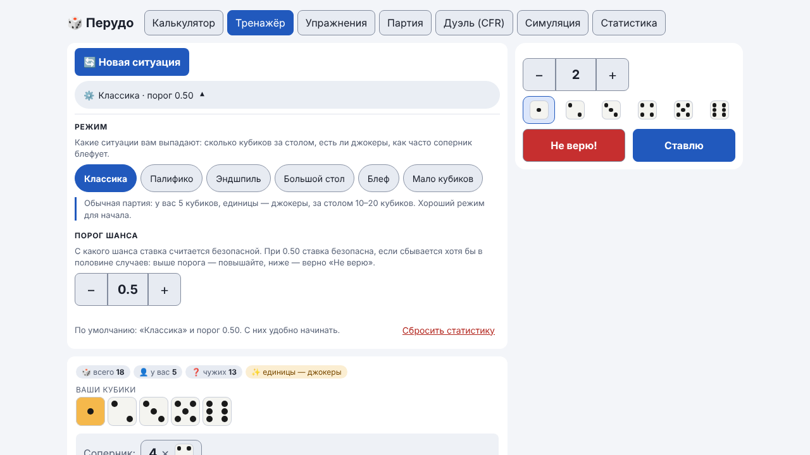

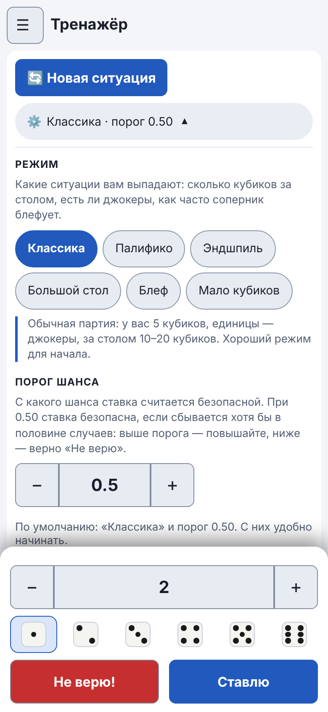

Режимы:

| Режим | Особенность |
|---|---|
| Классика | 10–20 кубиков на столе, 5 у вас, единицы — джокеры |
| Без джокеров / Палифико | все цифры выпадают с вероятностью 1/6 |
| Эндшпиль | на столе всего 3–6 кубиков: ваши кубики решают многое |
| Большой стол | 25–40 кубиков, работает «среднее ожидание» |
| Блефующий соперник | соперник часто завышает ставку |
| Мало кубиков у вас | у вас 1–2 кубика, рука почти ничего не говорит |

**Как работает повтор.** Ошибочные ситуации попадают в очередь и возвращаются (с пометкой «повтор»), пока вы не решите их верно **два раза подряд**. Одна и та же ситуация возвращается не сразу: между двумя её показами проходят минимум три другие ситуации, чтобы повтор проверял умение, а не память о только что увиденном ответе. Результаты по режимам видны в разделе [«Статистика»](#статистика-и-ваши-данные).

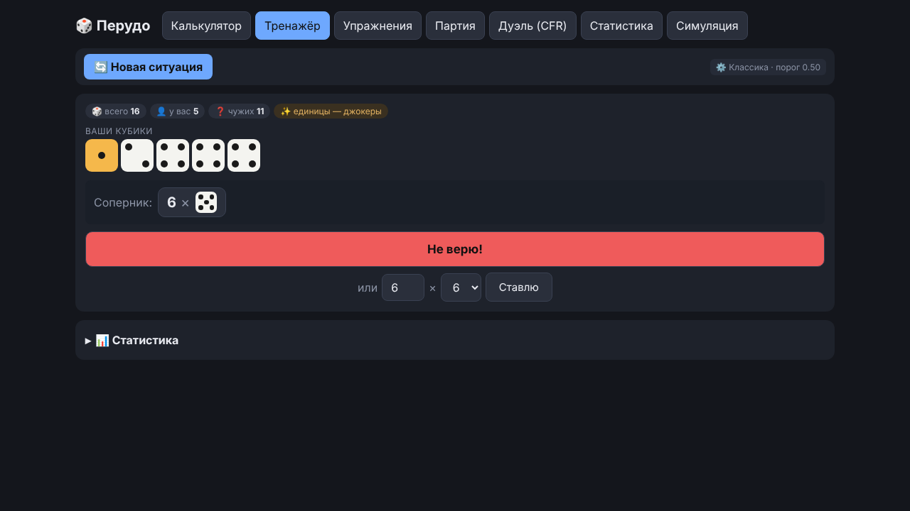

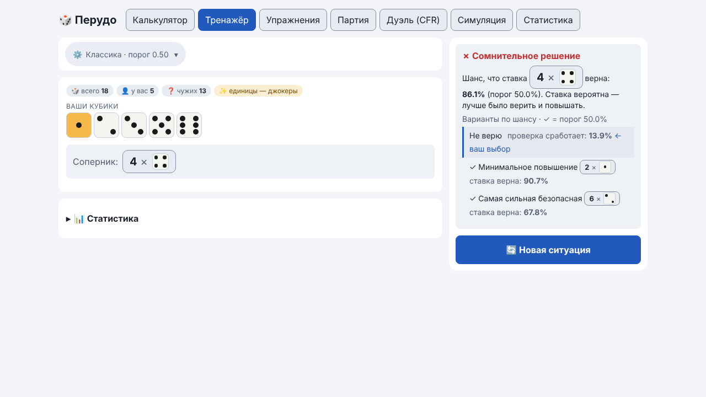

*Слева ситуация, справа панель ответа; после ответа в ней появляется разбор и кнопка «Новая ситуация».*

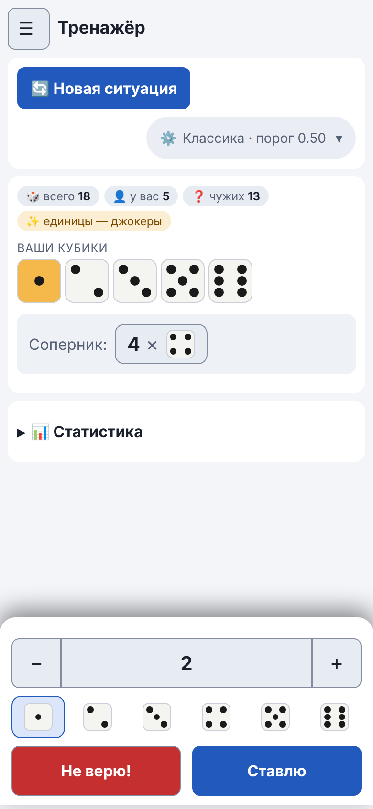

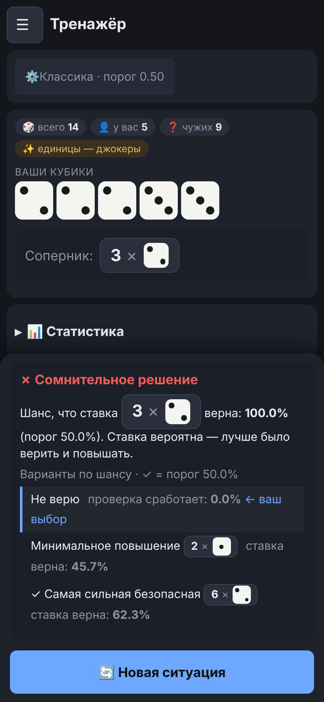

*На телефоне ответ выбирается внизу экрана (степпер, цифра, «Не верю!» / «Ставлю»), а после ответа на её месте появляется разбор.*

## Упражнения

Две тренировки счёта в уме. Каждый ответ проверяется сразу, а под вопросом лежит подсказка «Как это посчитать».

- **Оценка в уме.** Сколько кубиков с нужной цифрой ожидать на столе (число с дробью) и какая ставка «безопасна» (шанс не ниже 50%). Ожидание считается как *свои + чужие × шанс*, где шанс = 1/3 для обычной цифры и 1/6 для единиц. Безопасная ставка — ожидание, округлённое к ближайшему целому (ровно посередине — вниз): для 0–60 чужих кубиков это совпадает с точным расчётом, один и тот же приём работает и на большом, и на малом столе. В упражнении есть свёрнутая памятка «Как прикинуть в уме» с примером, а после ответа — разбор шагами с числами задачи.
- **Правило единиц.** Какое минимальное количество нужно назвать при переходе на единицы (⌈q/2⌉) и обратно (2q + 1).

Кнопка **«Новое»** выдаёт другой вопрос. Допуск при проверке ±1: это тренировка прикидки в уме, а не точного счёта. Если ответ выше безопасного, он принимается по допуску, но разбор добавляет строку про шанс («принята по допуску, но шанс 38% — меньше 50%; безопасная — 6 (61%)»). Бывает, что безопасной ставки нет (мало чужих кубиков, ставка на единицы): тогда правильный ответ 0, и разбор так и говорит.

**Что считается попыткой.** Одна задача — одна запись в статистике. Пустой, нечисловой или дробный ответ (где нужно целое число) не засчитывается: приложение просит ввести ответ. После проверки кнопка «Проверить» недоступна до нажатия «Новое».

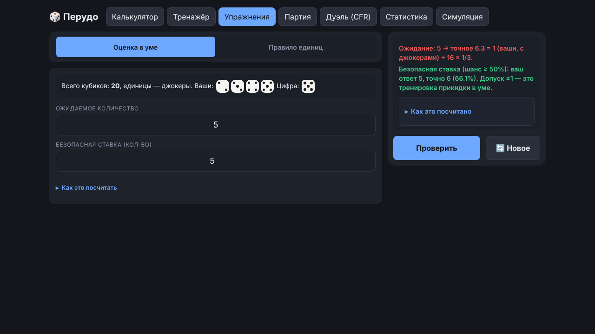

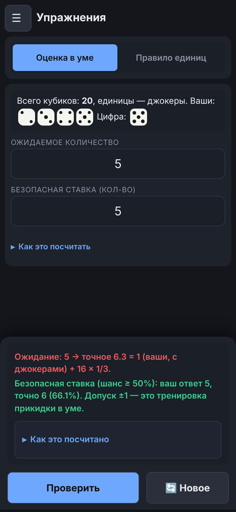

*Проверка и разбор находятся в панели у нижнего края (на широком экране справа); подробный разбор раскрывается внутри неё.*

## Партия

Полноценная игра против 1–5 компьютерных игроков. Приложение подсказывает шансы, показывает кубики при проверке и разбирает ваши решения. Ниже: как начать, какие бывают настройки, как играют боты и как выглядит партия на телефоне.

### Первая партия за минуту

1. Откройте вкладку **«Партия»**. Партия не начинается сама: вы видите экран подготовки с настройками в карточках (**Соперники**, **Помощь и темп**, **Дополнительные правила**). Стола и боковой панели до старта нет. Выбранные настройки запоминаются.
2. Нажмите **«Начать партию»**: кнопка закреплена внизу экрана, прокручивать настройки до неё не нужно. После старта настройки остаются во вкладке ⚙️ боковой панели.
3. На своём ходу выберите **количество** кубиков кнопками **−** и **+** и **цифру** на гранях, затем нажмите **«Ставлю»**.
4. Если считаете, что ставка соперника не сбудется, нажмите **«Не верю!»**.
5. Откроется окно, где видны кубики всех игроков и результат проверки. Нажмите **«Дальше»**.
6. В конце партии появится окно с победителем и кнопка **«Сыграть ещё»**.

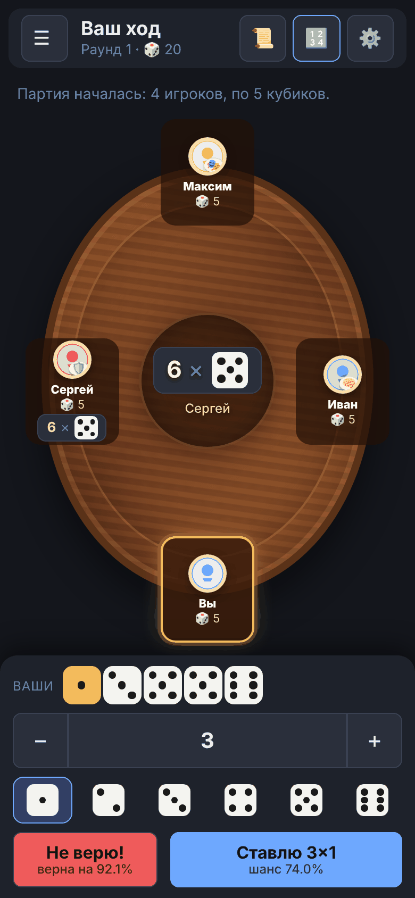

### Итог партии: ключевые моменты

После партии в карточке итога на вкладке «Разбор» (на телефоне — в шторке) показано, в какой теме больше всего ошибок, и раскрывающийся блок «Ключевые моменты»: до трёх самых важных ваших решений с вариантами хода по шансу ставки. У решения, где был чужой ход, есть кнопка **«Добавить в очередь повторов»**: ситуация записывается в очередь (без дублей), итог партии остаётся открытым, так что можно добавить и другие моменты; кнопка меняется на «В очереди повторов ✓». Позже эти ситуации подмешиваются в тренажёр с пометкой «повтор». Ваш первый ход в раунде в тренажёр не переносится: там нет ставки соперника. Сравнение идёт по шансу ставки, а не по выигрышу.

В окне итогов партии кнопка **«Перейти к расчёту»** закрывает окно и открывает вкладку «Расчёт» (на телефоне — шторку): карточка итога с ключевыми моментами оказывается наверху, и ситуации сразу можно добавлять в тренажёр.

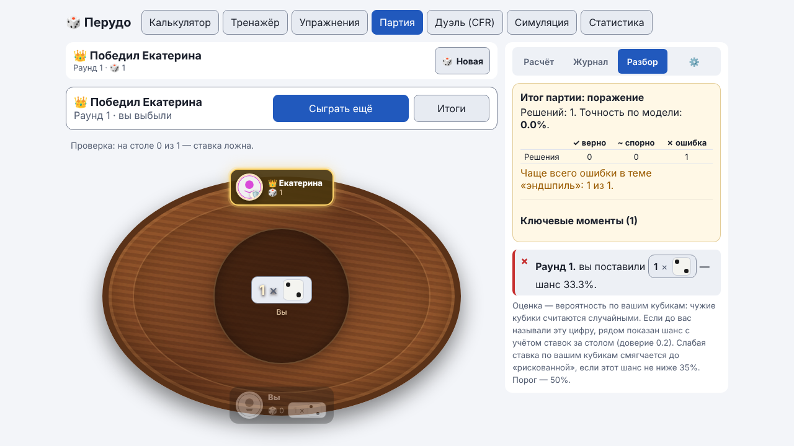

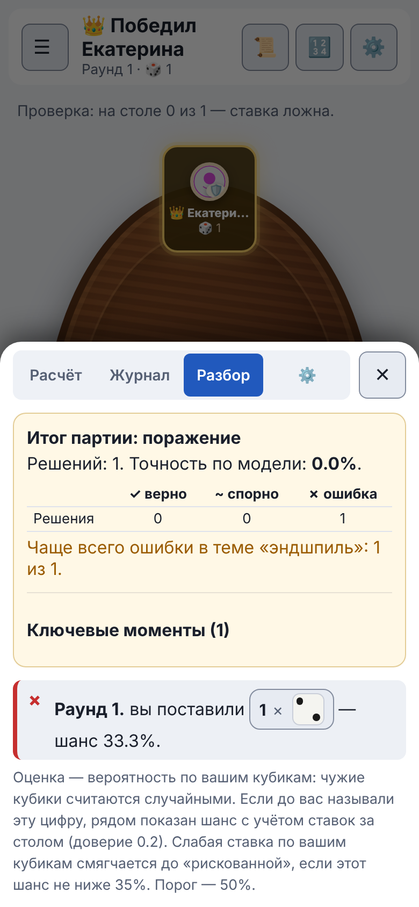

### Журнал партии

На вкладке «Журнал» по порядку записаны раунды, ставки и проверки. После каждой проверки видно, кто проиграл: «Дмитрий теряет кубик (осталось: 2)», а когда кубиков не осталось, — «✖ Анна остаётся без кубиков и выбывает из игры». Результат Calza и полученный кубик тоже записываются.

### Разбор ваших ходов

На вкладке «Разбор» каждый ваш ход получает оценку по шансу ставки по вашим кубикам: чужие кубики считаются случайными. Порог — 50%: от 50% «Надёжная ставка», от 35% «Рискованная», ниже «Слабая».

Если до вас в этом раунде называли ту же цифру, рядом показан **второй шанс — с учётом ставок за столом**: игрок, назвавший цифру, с большей вероятностью держит её на руках (доверие к ставке 0,2; значение зафиксировано в коде, `TABLE_TRUST`). Для первой ставки раунда и для цифр, которых никто не называл, числа совпадают, и показано одно. Ставка, которая слаба по вашим кубикам, но с учётом стола имеет шанс не ниже 35%, получает не красный крестик, а оценку «Рискованная ставка» с пояснением «соперники подтверждают цифру». Пороги 35% и 50% при этом не меняются, оценка «Не верю» считается по вашим кубикам.

### Настройки партии

Перед первой партией настройки показаны на экране подготовки («Новая партия»), в трёх карточках. Позже их можно менять во время игры: значок ⚙️ (на компьютере — вкладка «⚙️» справа от стола).

- **Кубиков каждому** — от 1 до 10.
- **Ботов** — от 1 до 5 (за столом получается от 2 до 6 игроков).
- **Бот 1, Бот 2…** — стиль каждого бота (см. раздел «Боты» ниже).
- **Уровень ботов** — как часто боты ошибаются в расчётах.
- **Боты запоминают мою игру** и кнопка **«Забыть мою игру»** — подстройка ботов под вас.
- **Режим помощи:**
  - **Новичок** — приложение показывает шансы и прямо советует ход;
  - **Тренировка** *(по умолчанию)* — показывает шансы, но решаете сами;
  - **Игра (без подсказок)** — как за настоящим столом.
- **Темп** — как быстро ходят боты: *Пошагово*, *Медленно*, *Нормально*, *Быстро*.
- **Дополнительные правила** — две карточки с переключателем и пояснением; для первой партии их можно оставить выключенными:
  - **Calza** — вместо «Не верю!» можно сказать «Calza»: «на столе ровно столько, сколько заявлено». Угадали — получаете кубик, ошиблись — теряете;
  - **Палифико** — когда остаётся один кубик, раунд идёт без джокеров и с фиксированной цифрой.
- Под списком «Режим помощи» одной строкой написано, что он включает. Что значат стили ботов и как повышать ставку, раскрывается внизу панели.
- **Показывать вскрытие кубиков** — окно с кубиками всех игроков после проверки. Если оно мешает, снимите галочку: результат всё равно останется в журнале.

Настройки применяются к *новой* партии: после изменения нажмите «Начать новую партию».

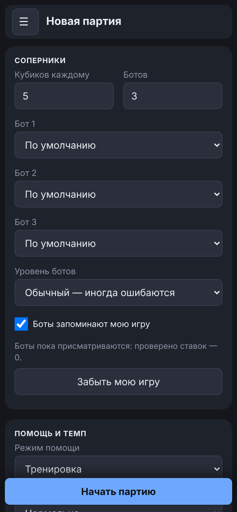

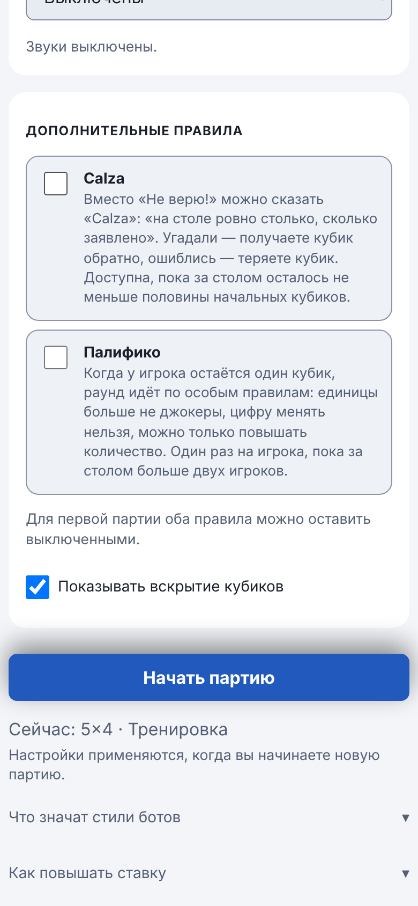

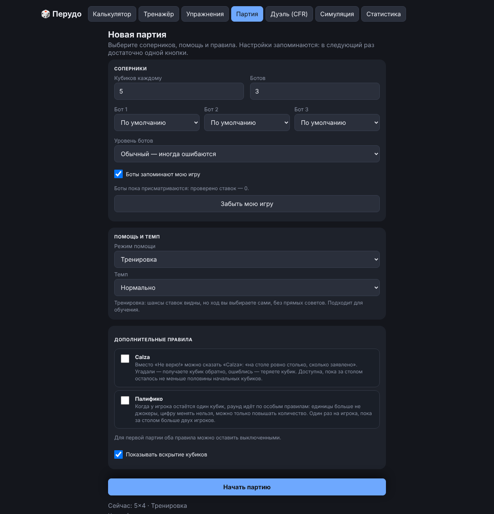

*Экран подготовки: карточки «Соперники», «Помощь и темп» и «Дополнительные правила»; кнопка «Начать партию» остаётся внизу экрана.*

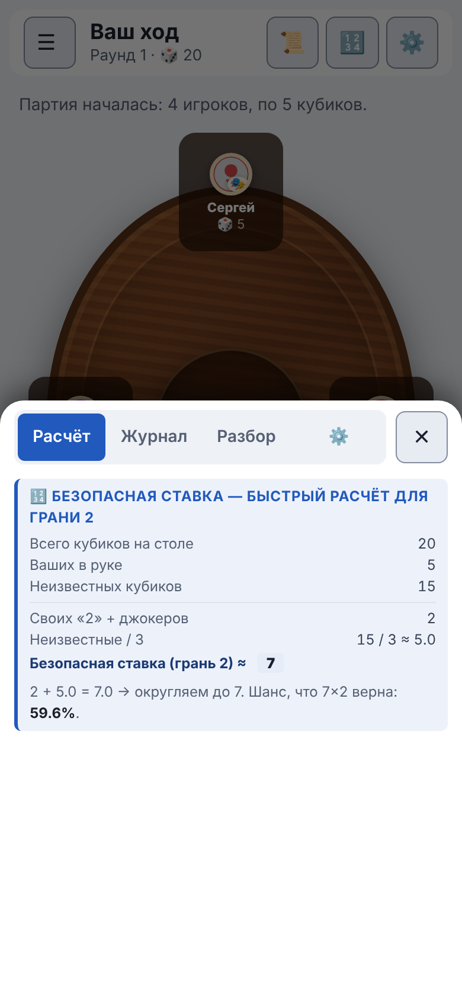

### Боты

За столом вы играете против компьютерных соперников. Бот видит только свои кубики, общее число кубиков и текущую ставку, в чужие кубики он не заглядывает. Как и живой игрок, он считает шансы, иногда блефует и иногда ошибается.

#### Стили

У каждого бота есть стиль, то есть манера игры. Значок стиля виден рядом с именем бота за столом.

| Стиль | Как играет | Как с ним играть |
|---|---|---|
| 🛡️ **Осторожный** | ставит только надёжно, почти не блефует | если он повысил, чаще всего он прав: верьте |
| 🎭 **Блефующий** | часто завышает ставку | проверяйте его ставки на «Не верю!» |
| 🧠 **Умный** | считает вероятности, умеет говорить Calza, лучше всех подстраивается под вас | самый сильный соперник |
| 🔥 **Агрессор** | быстро взвинчивает ставки, редко проверяет | не давайте себя разогнать: проверяйте на «Не верю!», когда ставка уже слишком высока |
| 🧐 **Скептик** | не доверяет чужим ставкам, часто говорит «Не верю!» | делайте надёжные ставки, а блефуйте реже |

Для каждого бота стиль выбирается отдельным списком в настройках: *По умолчанию*, *🎲 Случайный* или один из пяти стилей. Так можно, например, посадить за стол пятерых скептиков и потренироваться против них.

Если ничего не выбирать, первые три бота получат *Осторожного*, *Блефующего* и *Умного* по кругу. При 4–5 ботах стили повторяются.

#### Уровень ботов

Показывает, как часто боты ошибаются в оценке шансов, как живые игроки, которые считают «на глаз»:

- **Лёгкий** — ошибаются часто, подходит для начала;
- **Обычный** *(по умолчанию)* — ошибаются иногда;
- **Сильный** — считают точно и не ошибаются.

Размах ошибки зависит и от стиля: *Блефующий* и *Агрессор* ошибаются больше, *Умный* меньше всех.

#### Память: боты запоминают вашу игру

Если галочка **«Боты запоминают мою игру»** включена *(по умолчанию)*, боты замечают, как часто ваши проверенные ставки оказывались ложными:

- если вы часто блефуете, боты начинают чаще говорить вам «Не верю!»;
- если вы играете честно, боты чаще верят вашим ставкам.

Сильнее всех подстраивается *Умный*, почти не реагирует *Агрессор*. Под галочкой написано, сколько ваших ставок боты уже видели. Пока их меньше трёх, боты только «присматриваются»: поправка на ваш стиль совсем небольшая.

Важно знать:

- боты видят только **проверенные** ставки, как и живой соперник за столом: если вашу ставку никто не проверил, остаётся неизвестным, блефовали вы или нет;
- память хранится **только в вашем браузере** и сохраняется между партиями;
- кнопка **«Забыть мою игру»** стирает её, «Сбросить всё» во вкладке «Статистика» тоже;
- чтобы боты не подстраивались, снимите галочку (изменение применяется к новой партии).

### На телефоне и на компьютере

- **Компьютер:** слева стол и ваша панель действий, справа вкладки **«Расчёт»**, **«Журнал»**, **«Разбор»** и **«⚙️»**.
- **Телефон:** вся панель действий находится внизу экрана, под большим пальцем. Журнал, расчёт и настройки открываются снизу по значкам 📜 🔢 ⚙️ в верхней панели.
- **Меню разделов на телефоне.** Во время партии верхняя лента вкладок убирается, чтобы стол был больше. Кнопка **☰** в левом верхнем углу открывает список разделов.
- Телефон можно держать и горизонтально: стол будет слева, кнопки справа.

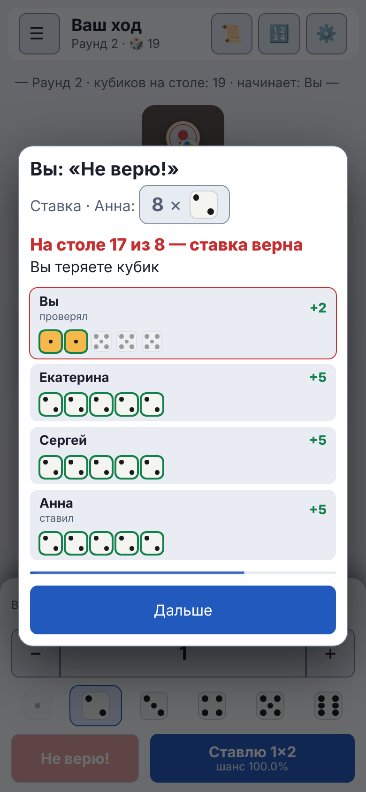

*Окно вскрытия: зелёной рамкой отмечены кубики, которые совпали со ставкой.*

## Дуэль (CFR)

Один раунд один на один: у каждого по одному кубику, единицы — джокеры, первая ставка не на единицы, проигравший проверку выбывает. Против вас играет бот, стратегию которого рассчитал алгоритм **CFR+** (минимизация сожаления) прямо в вашем браузере.

- **«Рассчитать равновесие»** — посчитать стратегию и посмотреть, с какой частотой бот открывает торги разными ставками при каждом своём кубике.
- **«Играть против оптимального бота»** — сыграть раунд: вы выбираете ставку или «Не верю!». Если стратегия ещё не посчитана, расчёт запустится сам.
- Под полем игры видны счёт «партий / побед» за сессию и число ваших редких отклонений от оптимальной стратегии.

Зачем это нужно: на одном кубике хорошо видно, что даже «оптимальный» игрок иногда блефует, а проверять каждую ставку подряд — тоже ошибка. Стратегия считается приближённо, поэтому говорим «близкая к оптимальной».

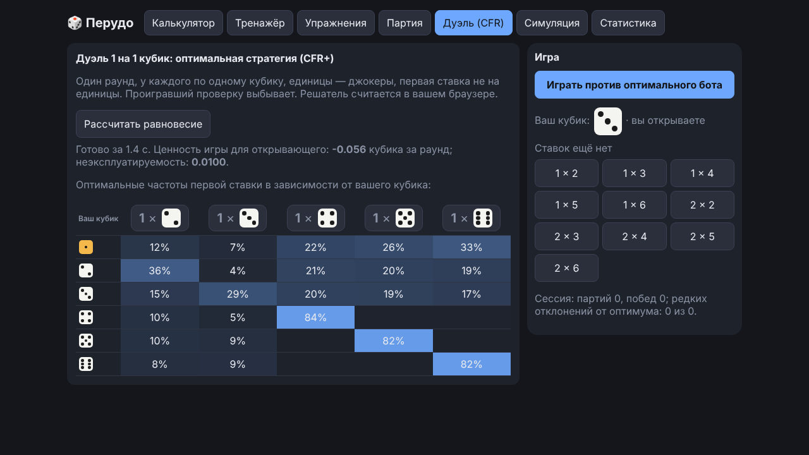

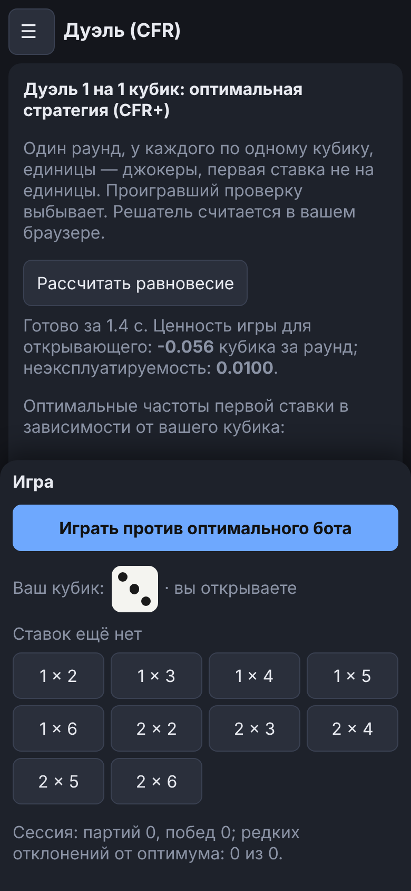

*Игра идёт в панели: на телефоне она у нижнего края экрана, на широком экране справа от таблицы равновесия.*

## Симуляция

Проверка формул на практике. Задайте число кубиков (по умолчанию 15), количество бросков (100 000) и джокеры, нажмите **«Запустить Монте-Карло»**: компьютер бросает кубики много раз и показывает, как часто ставка оказывается верной, когда рук никто не видит. Результат должен совпадать со столбцом «Формула», то есть с цифрами калькулятора. Это способ убедиться, что приложению можно доверять.

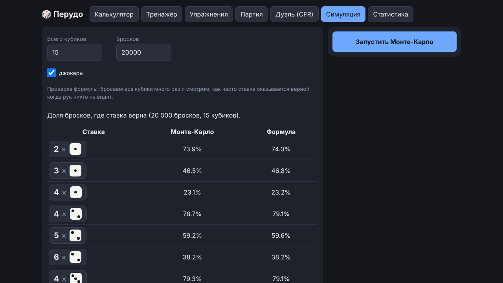

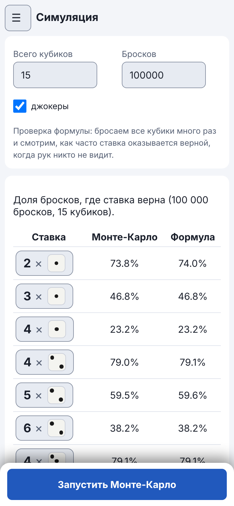

*Кнопка запуска всегда под рукой: на телефоне внизу экрана, на широком экране справа.*

## Статистика и ваши данные

Вкладка **«Статистика»** разделена на три части: **«Результаты»**, **«Игрок»** и **«Данные»**. Выбранная часть запоминается до закрытия страницы; переключаются мышью, касанием и стрелками ← →.

**Результаты** (открываются по умолчанию):

- **итоги крупно:** сколько партий сыграно (и побед), доля верных решений в тренажёре (сколько верно из скольких) и сколько ситуаций ждёт повтора. Пока данных мало, вместо процента стоит «мало данных»: процент по режиму считается от 8 решений, по партиям — от 5;
- **«Над чем поработать»:** до трёх тем, где доля решений с шансом ставки выше порога самая низкая (эндшпиль, последний кубик, Палифико, единицы, большой стол, проверки, повышения). Рядом число решений; темы, где их меньше 8, пока не оцениваются и перечислены отдельно. У тем с подходящим режимом есть кнопка **«Тренировать»**: открывает тренажёр в этом режиме;
- **сводка по режимам тренажёра** и **список партий**: одна строка на партию («19.10 · победа · 4 игрока · 19 раундов · 15 решений»), показаны последние 10, остальные по кнопке **«Показать все»** (всего хранится 200);
- если играть ещё не начинали, вместо таблиц с нулями — подсказка и кнопки «Сыграть партию» и «Открыть тренажёр».

**Игрок:** имя (до 20 символов) и аватар: эмодзи на выбор или своё фото (оно обрезается до квадрата и сжимается до нескольких килобайт прямо в браузере, на сервер не уходит). Выбор аватара свёрнут: видны имя и текущий аватар, сетка открывается по кнопке «Изменить». Имя и аватар видны за столом и в итогах партии вместо «Вы», меняются и посреди партии, входят в «Экспорт JSON».

**Данные:** всё про сохранность — блок «Копия на Яндекс Диске», «Копия в файле» (экспорт и импорт JSON, см. ниже) и подсказка про защиту от автоочистки браузера. В самом низу, отдельно, стоит **«Сбросить всё»**: стирает статистику, очередь повторов, статистику дуэли, память ботов и профиль игрока (с подтверждением).

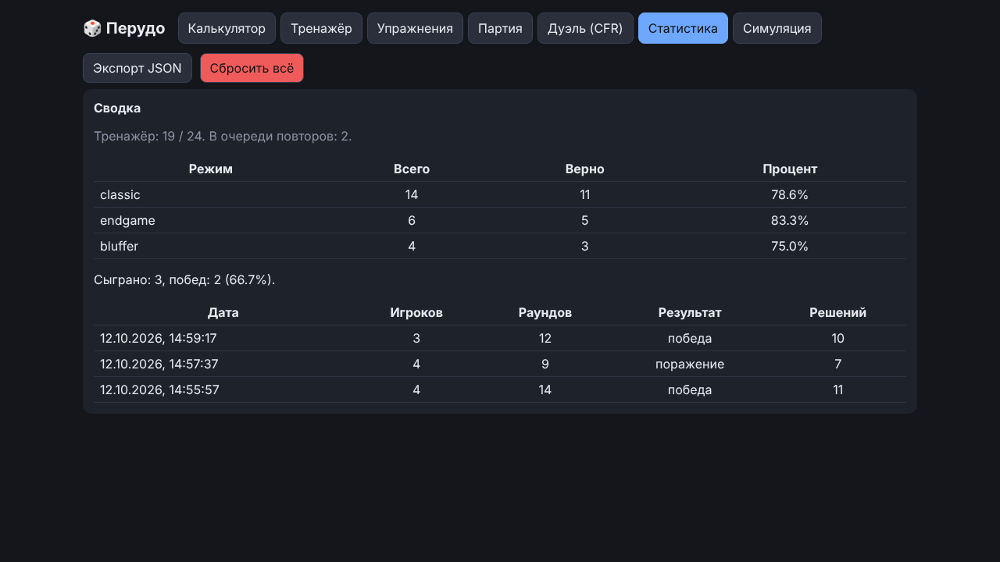

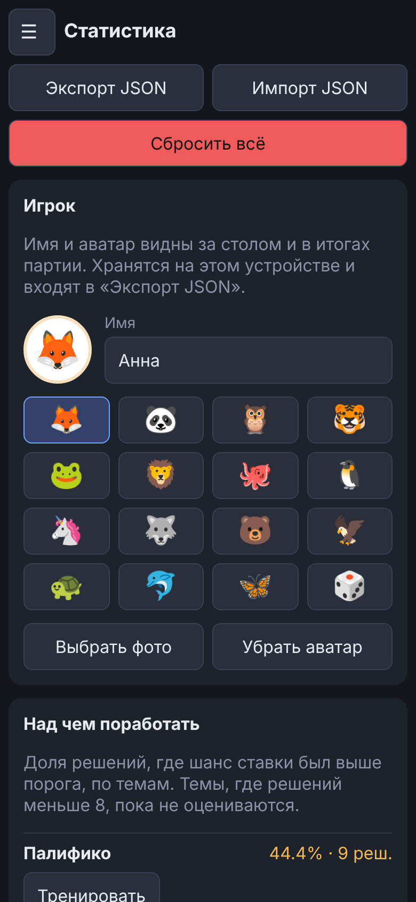

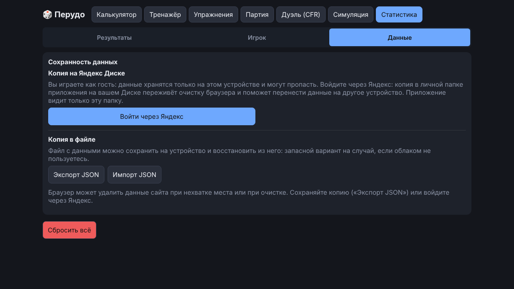

*На скриншотах демонстрационные данные.*

### Копия на Яндекс Диске

При первом запуске приложение спрашивает, как вы будете играть:

- **«Войти через Яндекс»:** копия ваших данных хранится на вашем Яндекс Диске. Она переживёт очистку браузера и поможет перенести данные на другое устройство;
- **«Играть как гость»:** данные хранятся только в этом браузере, как раньше. Выбор можно сменить позже: «Статистика» → «Данные».

**Уведомления.** Итог входа, обновление данных и ошибки облака показываются полосой под шапкой: она сдвигает страницу вниз и ничего не перекрывает. Справа есть кнопка «✕» (закрывает и клавиша Esc, если не открыто окно). Информация скрывается сама через 7 секунд, ошибки и просьбы выбрать остаются, пока вы их не закроете. Выбор «Играть как гость» уведомления не вызывает.

Как это устроено:

- **Что и куда пишется.** Один файл `perudo-backup.json` в личной папке приложения на вашем Диске: та же копия, что и «Экспорт JSON». Приложение получает право только на эту папку; остальные файлы Диска оно не видит. Данные не уходят ни на какой другой сервер: запросы идут из вашего браузера напрямую на Яндекс. Токен доступа хранится только на этом устройстве и в файл копии не входит.
- **Когда пишется.** После каждой законченной партии (не чаще раза в 30 секунд) и по кнопке **«Сохранить сейчас»**.
- **Другое устройство.** После входа с другого устройства приложение сравнивает версии. Если на этом устройстве ничего не менялось, а в облаке копия новее, данные обновляются сами. Если версии разошлись, вы выбираете, какую оставить. Данные не теряются без вашего подтверждения.
- **Если связь не работает.** Кнопка **«Диагностика связи»** собирает короткий отчёт (без токена и без ваших данных), его можно скопировать и отправить в Issues.
- **Выйти и удалить.** Кнопка **«Выйти»** убирает вход на этом устройстве: данные на устройстве и файл на Диске остаются. Чтобы удалить копию совсем, удалите файл `perudo-backup.json` из папки приложения на Диске; доступ приложения можно отозвать в настройках вашего аккаунта Яндекса.

### Где хранятся данные

- Статистика, история партий, настройки, память ботов о вашей игре, имя и аватар игрока и записи ваших решений в партиях (счётчики по типам ситуаций и до трёх самых важных моментов каждой законченной партии, всего не больше 50) хранятся **только в вашем браузере**. Если вы играете как гость, приложение ничего никуда не отправляет и не требует аккаунта; при входе через Яндекс копия данных дополнительно записывается на ваш Диск (см. выше).
- Если открыть приложение в **другом браузере**, на другом устройстве или в режиме инкогнито, статистики там не будет. Если очистить данные сайтов в настройках браузера, она тоже пропадёт.
- **Сохранить копию в файл:** «Статистика» → «Данные» → **«Экспорт JSON»**. Получится файл `perudo-backup-ГГГГ-ММ-ДД.json` со всеми данными: статистикой тренажёра, очередью повторов, историей партий и разборами, статистикой дуэли, настройками, профилем, прогрессом обучения, характерами и памятью ботов.
- **Защита от автоочистки.** После первой и после пятой партии приложение просит браузер не удалять данные сайта само (`navigator.storage.persist()`); решает браузер, а во вкладке «Статистика» → «Данные» показано, защищено ли хранилище. Это не защита от ручной очистки: копия в файле остаётся главным способом сохранить данные.
- **Напоминание.** После пятой партии в итоге партии появляется предложение сохранить копию; «Позже» откладывает его ещё на 20 партий, после экспорта оно молчит 30 партий. Когда напоминать, хранится отдельно (ключ `perudo.device`) и в копию JSON не входит.
- **Восстановить копию из файла:** «Статистика» → «Данные» → **«Импорт JSON»** → выберите файл. Приложение проверит файл и спросит подтверждение: текущие данные **заменяются** данными из копии, после чего страница перезагружается. Если файл чужой, повреждён или сделан более новой версией, будет понятное сообщение, а ваши данные не изменятся. Файлы старого формата (версия 1) тоже читаются.
- **Начать с нуля:** «Статистика» → «Данные» → **«Сбросить всё»** (память ботов и записи решений тоже очищаются). Забыть только вашу игру можно кнопкой в настройках партии.

## Частые вопросы

**Нужен ли интернет?** Только чтобы открыть страницу. После загрузки играть можно без сети, но обновить страницу без интернета не получится.

**Бот сходил, а я не успел прочитать.** Выберите темп **«Пошагово»** или **«Медленно»**, а ход бота смотрите во вкладке «Журнал».

**Откуда берутся проценты?** Расчёт идёт по вашим кубикам и по числу неизвестных кубиков на столе. Каждый чужой кубик с нужной цифрой (или единицей-джокером) выпадает с вероятностью 1/3, а для единиц и в Палифико — 1/6. Подробности — во вкладке «Упражнения» → «Как это посчитать».

**Статистика пропала.** Скорее всего, вы открыли приложение в другом браузере или очистили данные сайтов. См. раздел «Ваши данные».

**Что-то не работает или хочется улучшить.** Напишите об этом на странице проекта в разделе **Issues**.

---

# Часть 2. Для разработчиков

Приложение написано на чистых **HTML, CSS и JavaScript (ES-модули)**: без сборки и фреймворков, весь код работает прямо в браузере; для запуска приложения ничего устанавливать не нужно. Node.js и npm-пакеты `@playwright/test` и `playwright` (в `devDependencies`) нужны только для тестов.

## Запуск локально

```bash
git clone https://github.com/Wwwoper/perudo-trainer.git
cd perudo-trainer

python3 -m http.server 8000      # или: npm start
# откройте http://localhost:8000
```

Открыть `index.html` двойным кликом **не получится**: браузеры запрещают загрузку ES-модулей с адресов `file://`. Подойдёт любой статический сервер (`npx serve`, расширение Live Server и т. п.).

## Публикация на GitHub Pages

1. Загрузите проект в репозиторий на GitHub (файл `index.html` должен лежать в корне).
2. **Settings → Pages → Build and deployment → Source: «Deploy from a branch»**.
3. Выберите ветку `main` и папку `/ (root)`, нажмите **Save**.
4. Через минуту-две приложение откроется по адресу вида `https://<ваш-логин>.github.io/<репозиторий>/` (у этого проекта — https://wwwoper.github.io/perudo-trainer/). Все пути в проекте относительные, поэтому никакой настройки базового адреса не нужно.

## Тесты

В проекте несколько наборов тестов, они проверяют разное:

| Набор | Что проверяет | Команда |
|---|---|---|
| Логика (`tests/*.test.js`, `tests/core.test.cjs`) | правила, движок, боты, подсказки, итог и вскрытие, стол, хранилище, стили (`css.test.js`), расчёт вероятностей и CFR (`core.test.cjs`), README (`readme.test.js`: ссылки, картинки, якоря) и `<head>` страницы (`head.test.js`). Браузер не нужен | `npm test` |
| Эмуляторы (`tests/emulators.test.js`) | Python-порты из `tools/` против приложения: правила, вероятности, решения ботов, партии ход в ход; сообщение об отклонении ставки в тренажёре. Нужен `python3`, без него тест пропускается | `npm test` |
| Сценарии (`tests/e2e/*.spec.js`) | партия, учебные вкладки, запись решений, итог партии и «Над чем поработать», резервная копия: в настоящем браузере на двух экранах (компьютер и телефон) | `npm run test:e2e` (с окном отладки: `npm run test:e2e:ui`) |
| Вёрстка (`tests/test_layout.py`) | размеры, шторка, меню, прокрутка, окна; панели ставки в Калькуляторе, Тренажёре и Упражнениях | `python3 -m unittest tests.test_layout` |
| Вёрстка учебных вкладок (`tests/test_learning_layout.py`) | на пяти размерах экрана: нет горизонтальной прокрутки, нет элементов меньше 44 px и полей меньше 16 px, результат виден на экране | `python3 -m unittest tests.test_learning_layout` (несколько секунд; таблицу показателей печатает `python3 -m tests.layout_audit`) |

Тесты логики нужен только Node.js 18+: `npm test` запускает `node --test` для `*.test.js` и `*.test.cjs`. Файл `core.test.cjs` читает `src/core.js` в изолированном контексте (`node:vm`), потому что это классический скрипт для `<script>`, а не ES-модуль.

Тесты вёрстки запускаются в настоящем браузере (Chromium) через Playwright для Python и проверяют вёрстку: места игроков внутри стола, размеры кнопок, шторку, меню, окна вскрытия и итога, отсутствие прокрутки страницы и так далее:

```bash
pip install playwright && playwright install chromium
python3 -m unittest tests.test_layout           # весь набор (около двух минут)
SHOTS_DIR=./shots python3 -m unittest tests.test_layout   # заодно сохранить скриншоты
```

Сценарии игры в браузере (стол, ставка, «Не верю», Calza, подсказки, окно вскрытия) проверяет Playwright Test на двух экранах: десктопном и телефонном. Он сам поднимает небольшой локальный сервер (`tests/e2e/static-server.mjs`, без зависимостей):

```bash
npm install                      # один раз: ставит @playwright/test
npx playwright install chromium  # один раз: скачивает браузер
npm run test:e2e                 # tests/e2e/table.spec.js
```

> Файл `*.spec.js` — это формат Playwright Test, его нельзя запускать через `node --test`, поэтому `npm test` его не трогает.

## Структура проекта

```
index.html           разметка всех вкладок и небольшой скрипт настроек
package.json         скрипты npm (test, test:e2e, test:e2e:ui, start), devDependencies для e2e
package-lock.json    зафиксированные версии npm-пакетов
playwright.config.js настройки e2e-тестов (десктоп и телефон)
tools/               эмуляторы партий, тренажёра и упражнений на Python (см. tools/README.md)
.github/workflows/   проверка тестов на GitHub при каждом push и pull request
LICENSE              лицензия MIT
.nojekyll            отключает Jekyll на GitHub Pages
README.md            это описание (GitHub показывает его на главной странице)
src/
├── app_v2.js        точка входа: запуск вкладок и ядро партии (ход игры, стол, ход бота)
├── ui/              части интерфейса: common.js (помощники), modes.js (режимы тренажёра), tabs.js (разделы и ☰), calculator.js, trainer.js, drill.js, duel.js, sim.js, stats.js (вкладки), side_panel.js (панель партии), bot_styles.js и bot_mind.js (настройки ботов), reveal_dialog.js и result_dialog.js (окна партии), decisions.js (запись решений), key_moments.js (итог: ключевые моменты), options_view.js (список вариантов хода), weak_spots.js (блок «Над чем поработать»), player_card.js (блок «Игрок»), stats_tabs.js (подвкладки статистики), cloud_card.js (блок «Копия на Яндекс Диске»), backup_reminder.js (напоминание о копии в итоге партии)
├── core.js          вероятности, симуляция, решатель CFR (классический скрипт, глобальный Perudo)
├── rules.js         правила ставок: legal(), minLegal()          ← чистая логика
├── engine.js        игровой движок без привязки к интерфейсу     ← чистая логика
├── bots.js          стили ботов, ошибки в расчётах, принятие решений ← чистая логика
├── memory.js        что боты помнят об игроке (доля блефа)       ← чистая логика
├── assist.js        режимы помощи, оценка решений                ← чистая логика
├── result.js        итог партии: победитель, тексты окна         ← чистая логика
├── moments.js       ключевые решения партии: метки, отбор, чтение   ← чистая логика
├── compare.js       сравнение вариантов хода по шансу ставки       ← чистая логика
├── repeat_pick.js   выбор повтора с паузой между показами          ← чистая логика
├── backup_reminder.js  когда напомнить про копию, сколько раз просили хранилище ← чистая логика
├── cloud_policy.js  правила облачной копии: что делать при запуске      ← чистая логика
├── cloud_yandex.js  копия в папке приложения на Яндекс Диске игрока   ← чистая логика (fetch передаётся)
├── persistence.js   просьба к браузеру не удалять данные сайта    ← чистая логика
├── avatar_photo.js  обрезка и сжатие фото аватара (расчёты)     ← чистая логика
├── player.js        профиль игрока: имя и аватар, проверка данных  ← чистая логика
├── weak_spots.js    слабые темы по счётчикам решений               ← чистая логика
├── stats_summary.js итоги статистики: проценты, «мало данных», пустое состояние ← чистая логика
├── stats_tabs.js    подвкладки статистики: выбор и клавиши          ← чистая логика
├── games_list.js    строки списка партий                          ← чистая логика
├── trainer_rules.js проверка ставки в тренажёре по правилам          ← чистая логика
├── drill_rule.js    правило «ожидание → безопасная ставка»           ← чистая логика
├── drill_input.js   разбор ответов в упражнениях                    ← чистая логика
├── drill_note.js    пояснения к ответу в «Оценке в уме»             ← чистая логика
├── table_read.js    шанс с учётом ставок за столом для «Разбора»     ← чистая логика
├── backup.js        формат и проверка резервной копии              ← чистая логика
├── cloud_sync.js    запись и восстановление копии в облаке        ← чистая логика (fetch передаётся)
├── cloud_diag.js    отчёт «Диагностика связи» (без токена)         ← чистая логика
├── reveal.js        модель окна вскрытия кубиков                 ← чистая логика
├── game_log.js      строки журнала партии: потеря кубика, выбывание, Calza ← чистая логика
├── table.js         отрисовка стола и мест игроков (строки HTML)
├── storage.js       localStorage с версией схемы
├── table.css        стол и места игроков
└── css/             base, game, learn, components, trainer, drill
tests/
├── *.test.js        тесты логики (node --test)
├── core.test.cjs    тесты core.js: вероятности и CFR (node --test)
├── e2e/table.spec.js  сценарии партии в браузере (Playwright Test)
├── e2e/learning.spec.js  сценарии Калькулятора, Тренажёра и Упражнений
├── e2e/stats.spec.js  сценарии статистики
├── e2e/helpers.js   общие помощники e2e (открыть вкладку на телефоне через ☰)
├── e2e/static-server.mjs  сервер статики для этих тестов
├── __init__.py      делает папку пакетом для `python3 -m unittest`
├── test_layout.py   тесты вёрстки в браузере (Playwright)
├── test_learning_layout.py  пороги вёрстки учебных вкладок
└── layout_audit.py  измеритель вёрстки учебных вкладок (таблица показателей)
docs/img/            скриншоты для README (game-desktop.png также служит превью ссылки)
```

## Как устроен код

Слои в общих чертах идут снизу вверх, и нижние ничего не знают о верхних:

```
rules.js → engine.js → memory.js / bots.js / assist.js → result.js / reveal.js / table.js → app_v2.js
```

- **Логика отделена от интерфейса.** `rules`, `engine`, `bots`, `assist`, `result`, `reveal`, `moments`, `compare` — чистые функции без DOM, поэтому они тестируются в Node за доли секунды.
- **Ошибки и память ботов.** `botDecide` получает необязательные `noise` (множитель из `noiseForLevel(level)`; 0 — без ошибок) и `opponent` (`{ bluffRate, samples }` из `opponentModel`). Ошибка — равномерный сдвиг оценки вероятности в пределах `noise` стиля, один на ставку за ход. Память — поправка к оценке *текущей* ставки человека: `adapt × (bluffRate − 0,3)`, не больше ±0,25. Без `noise` и `opponent` функция по-прежнему детерминирована. `memory.js` ничего не знает о браузере: сохраняет её `app_v2.js` через `storage.js` (ключ `perudo.botMemory`), а пополняется она событиями движка `DICE_REVEALED` с `kind: 'dudo'`.
- **Новый стиль бота** — это запись в `BOT_STYLES` (`src/bots.js`): имя, значок, описание и параметры (`raiseMin`, `dudoBelow`, `bluff`, `calza`, `noise`, `adapt`; смысл каждого описан комментарием над списком). Выпадающие списки в настройках и подсказка строятся из этого объекта сами, менять разметку не нужно. Тест `tests/bot-styles.test.js` проверит новую запись сам: пороги в диапазоне 0–1, уникальные имя и значок.
- **Формат ставки везде `{ q, f }`** (количество и грань). В движке `game.bid = { q, f, playerId, playerName }`.
- **Интерфейс перерисовывается функцией `renderGame()`**, а стол строится строкой HTML в `table.js`. Окна вскрытия и итога — нативные `<dialog>`.
- **Хранилище.** Все данные лежат в `localStorage` под ключами `perudo.*` (см. `storage.js`, там же версия схемы).
- **Для отладки и тестов** в консоли доступен объект `window.__perudo_v2` (`game`, `startNewGame`, `renderGame`).

### API движка

```javascript
import { createGame, startGame, applyAction, getLegalActions, getPublicState } from './src/engine.js';

const game = createGame({
  playerId: 'human',
  botCount: 2,
  startDice: 5,
  calzaEnabled: true,
  palificoEnabled: true,
  assistMode: 'training',
  botSpeed: 'normal',          // необязательно: темп ботов (для интерфейса)
  botNames: ['Иван', 'Мария'], // необязательно: имена ботов вместо случайных
});
// botCount — целое от 1 до 5, startDice — целое от 1 до 10 (константа LIMITS),
// иначе createGame бросает RangeError.

startGame(game);

getLegalActions(game, 'human');                       // допустимые действия игрока
const res = applyAction(game, 'human', { type: 'raise', quantity: 8, face: 4 });
// также { type: 'dudo' } и { type: 'calza' }
// res = { success, events } либо { success: false, error }

getPublicState(game);                                 // без скрытых рук
```

### События движка (`res.events`)

| Событие | Когда |
|---|---|
| `GAME_STARTED`, `GAME_ENDED` | начало и конец партии |
| `ROUND_STARTED`, `DICE_ROLLED` | новый раунд, раздача кубиков |
| `BID_PLACED` | сделана ставка |
| `DUDO_CALLED`, `CALZA_CALLED` | вызов проверки |
| `DICE_REVEALED` | кубики вскрыты: `kind` (`dudo`/`calza`), `bid`, `actualCount`, `bidSuccessful` или `calzaExact`, `wild`, `challengerId`, `bidderId`, `loserId`, **`hands`** (копия рук всех живых игроков: после вскрытия движок сразу раздаёт новые кубики) |
| `PLAYER_LOST_DIE`, `PLAYER_GAINED_DIE` | изменилось число кубиков |
| `PLAYER_ELIMINATED` | игрок выбыл |
| `PALIFICO_STARTED` | начался раунд Палифико |

## Адаптивная вёрстка

- Брейкпоинты: **≤ 719px** (телефон), **≤ 1100px** (шторка вместо правой колонки), **низкий ландшафт** (`max-height: 500px`).
- На телефоне панель действий прижата к низу экрана (зона большого пальца), все цели нажатия не меньше 44px.
- Положения мест за столом задаются в процентах (`--x/--y` для широкого стола и `--mx/--my` для телефона) и зажимаются через `clamp()`, чтобы место никогда не выходило за сцену.
- Калькулятор, Тренажёр, Упражнения, Дуэль и Симуляция собраны по той же схеме, что и Партия: основная область и **панель действий** (`.action-dock`). На телефоне панель прижата к низу экрана, на экранах от 720px и в низком ландшафте это правая колонка. Общие стили учебных вкладок лежат в `src/css/learn.css`. «Статистика» — страница без панели: кнопки сверху, таблицы помещаются в карточку.
- Шапка разделов на телефоне во всех разделах схлопывается в кнопку ☰ с заголовком раздела (атрибут `body[data-compact-nav]`); лента разделов остаётся в шапке на экранах от 720 px.
- Поля ввода не меньше 44px по высоте, шрифт 16px (iOS не увеличивает страницу при фокусе). Проверяет `tests/test_learning_layout.py`.
- Тест `tests/css.test.js` следит, чтобы в CSS не оставалось неиспользуемых классов, а в `index.html` не появились встроенные `<style>`.

## Как внести вклад

1. Сделайте fork и создайте ветку от `main`.
2. Работайте небольшими шагами: одно изменение — один коммит.
3. К новой логике добавляйте тесты (`tests/*.test.js`), к изменению вёрстки — проверки в `tests/test_layout.py`.
4. Перед отправкой запустите `npm test` и, если трогали интерфейс, `npm run test:e2e` и `python3 -m unittest tests.test_layout`.
5. Откройте Pull Request с описанием, что и зачем изменено (для вёрстки — со скриншотами «до/после»).

Идеи для вклада: сохранение настроек партии между запусками, звуки, английская версия интерфейса, воспроизведение сыгранной партии.

## Лицензия

[MIT](https://github.com/Wwwoper/perudo-trainer/blob/main/LICENSE) — используйте и изменяйте свободно.
