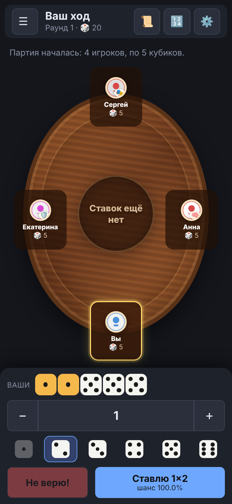

# 🎲 Перудо — тренажёр и игра в браузере

Играйте в **Перудо** (она же «Дудо», «Игра лжецов» с кубиками) против компьютерных соперников и учитесь считать шансы: приложение подсказывает, насколько вероятна чужая ставка, разбирает ваши решения и тренирует главные навыки игры.

**▶ [Открыть приложение](https://wwwoper.github.io/perudo-trainer/)** · **📖 [Руководство для новичков](https://wwwoper.github.io/perudo-trainer/docs/guide/)**

Ничего устанавливать не нужно: приложение работает прямо в браузере на компьютере, планшете и телефоне, без регистрации и без рекламы.

  
  
  
  

## Что умеет

- **Калькулятор** показывает шанс, что чужая ставка верна, и подсказывает, верить ей или нет.
- **Тренажёр** и **Упражнения** учат принимать решения «верить или нет» и считать в уме; ошибки возвращаются, пока вы не исправите их.
- **Партия** против 1–5 ботов с разными стилями и уровнями, с правилами Calza и Палифико, подсказками, разбором ходов и ключевыми моментами.
- **Дуэль** один на один против бота со стратегией CFR+ и **Симуляция** для проверки формул.
- **Статистика** показывает результаты и слабые темы; данные можно сохранить в файл или на Яндекс Диск.
- Светлая и тёмная темы, звуки (по желанию), удобный вид на телефоне.

## С чего начать

Откройте [приложение](https://wwwoper.github.io/perudo-trainer/) и нажмите «Партия» → «Начать партию». Если Перудо вам незнакомо, сначала прочитайте [правила](https://wwwoper.github.io/perudo-trainer/docs/guide/rules.html) и [быстрый старт](https://wwwoper.github.io/perudo-trainer/docs/guide/quick-start.html).

## Руководство

[Оглавление](https://wwwoper.github.io/perudo-trainer/docs/guide/) · [Быстрый старт](https://wwwoper.github.io/perudo-trainer/docs/guide/quick-start.html) · [Правила](https://wwwoper.github.io/perudo-trainer/docs/guide/rules.html) · [Калькулятор](https://wwwoper.github.io/perudo-trainer/docs/guide/calculator.html) · [Тренажёр](https://wwwoper.github.io/perudo-trainer/docs/guide/trainer.html) · [Упражнения](https://wwwoper.github.io/perudo-trainer/docs/guide/drill.html) · [Партия](https://wwwoper.github.io/perudo-trainer/docs/guide/game.html) · [Настройки и боты](https://wwwoper.github.io/perudo-trainer/docs/guide/game-settings.html) · [Разбор партии](https://wwwoper.github.io/perudo-trainer/docs/guide/game-review.html) · [Дуэль и Симуляция](https://wwwoper.github.io/perudo-trainer/docs/guide/duel-sim.html) · [Статистика](https://wwwoper.github.io/perudo-trainer/docs/guide/stats.html) · [Ваши данные](https://wwwoper.github.io/perudo-trainer/docs/guide/data.html) · [Частые вопросы](https://wwwoper.github.io/perudo-trainer/docs/guide/faq.html)

Что-то не работает или хочется улучшить? Напишите на странице проекта в разделе **Issues**.

## Разработчикам

Приложение написано на чистых HTML, CSS и JavaScript (ES-модули), без сборки и фреймворков. Запуск, тесты и правила вклада: [CONTRIBUTING.md](CONTRIBUTING.md). Устройство кода: [docs/dev](docs/dev/README.md). Что нового в каждой версии: [CHANGELOG.md](CHANGELOG.md).

## Лицензия

[MIT](https://github.com/Wwwoper/perudo-trainer/blob/main/LICENSE) — используйте и изменяйте свободно.
